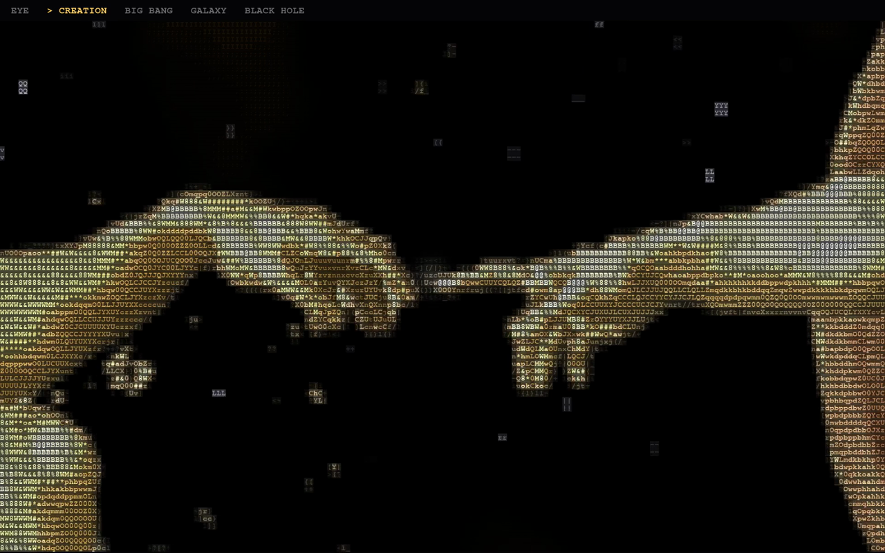

# Eye of Creation

[English](README.md) · **Türkçe**

Bir gözün içine dalıp evrenin doğuşuna giden, ardından kara deliğin içinden tekrar o göze dönen ASCII sinematik döngü. Python + pygame ile gerçek zamanlı çalışıyor. Aynı döngü **macOS, Windows ve Linux** için ekran koruyucu olarak da kurulabiliyor.

**EYE → CREATION → BIG BANG → GALAXY → BLACK HOLE → EYE**



## Çalıştırma

```bash
python3 -m venv eye-env
source eye-env/bin/activate          # Windows: eye-env\Scripts\activate
pip install -r requirements.txt
python eye_of_creation.py
```

| Tuş | İşlev |
| --- | --- |
| `SPACE` | duraklat / devam |
| `1`–`5` | sahneye atla |
| `←` / `→` | hız |
| `C` | renk modu (COLOR / MATRIX / MONO) |
| `ESC` | çıkış |

> Python 3.14'te orijinal `pygame` paketinin font modülü bozuk. Bu yüzden `requirements.txt` onun birebir uyumlu sürümü olan `pygame-ce`'yi kuruyor.

## Ekran koruyucu

Ekran koruyucular, döngünün önceden render edilmiş 55 saniyelik dikişsiz videosunu oynatıyor (`assets/EyeOfCreation.mp4`, 1920×1200). Kurulum scriptleri videoyu `assets/` klasöründe aradığı için repoyu klasör olarak değil, **tamamen** indir.

### macOS

Xcode Command Line Tools gerekiyor (`xcode-select --install`).

```bash
./macos/install.sh
```

Script `EyeOfCreation.saver`'ı derleyip `~/Library/Screen Savers` içine kopyalıyor ve Ekran Koruyucu ayarlarını açıyor. Listeden **Eye of Creation**'ı seç.

### Windows

**`windows\install.bat`**'a çift tıkla.

Script ekran koruyucuyu ve videoyu `%LOCALAPPDATA%\EyeOfCreation` içine kopyalıyor, ardından Ekran Koruyucu ayarlarını Eye of Creation seçili şekilde açıyor. Başka bir şey kurman gerekmiyor; Windows 10/11'de hazır gelen .NET Framework 4.8 ile çalışıyor. Birden fazla monitör varsa her birinde ayrı oynatılıyor.

> `.scr` dosyası imzasız olduğu için SmartScreen ilk seferde uyarabilir. **Ek bilgi → Yine de çalıştır**'a tıkla.

### Linux

[XScreenSaver](https://www.jwz.org/xscreensaver/) ve [mpv](https://mpv.io/) gerekiyor:

```bash
sudo apt install xscreensaver mpv     # Fedora: dnf, Arch: pacman -S
./linux/install.sh
```

Script, Eye of Creation'ı XScreenSaver'a "hack" olarak ekliyor. `xscreensaver-settings` içinden seçmen yeterli. GNOME ve KDE'nin kendi kilit ekranları özel ekran koruyucuyu desteklemiyor, bu yüzden XScreenSaver şart (en iyi X11'de çalışıyor).

## Videoyu yeniden üretmek

Kodda bir şey değiştirirsen ekran koruyucu videosunu yeniden üret (ffmpeg gerekir):

```bash
EOC_W=1920 EOC_H=1200 EOC_SAVER=1 python tools/record.py assets/EyeOfCreation.mp4
```

## Ekran koruyucuları kendin derlemek

- **macOS:** `macos/build.sh` ile derlenir (Swift; Xcode projesi gerekmez). GitHub Actions her push'ta derliyor, `v*` tag'lerinde `.saver`'ı release'e ekliyor.
- **Windows:** `dotnet build windows -c Release` çalıştır, çıkan `EyeOfCreation.exe`'nin adını `EyeOfCreation.scr` yap. macOS ve Linux'ta da derlenebiliyor.

## Notlar

- CREATION sahnesindeki eller, Michelangelo'nun *Adem'in Yaratılışı* freskinden (Sistina Şapeli, kamu malı) alındı. Görsel kodun içine gömülü.
- [@erfanxasadi](https://www.instagram.com/erfanxasadi/)'nin "Eye of Creation" reel'inden ilham alındı.
